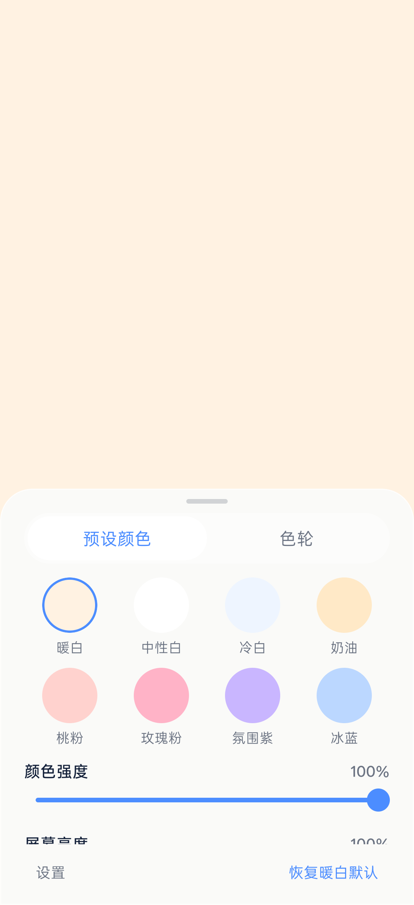

# Night Fill Light

Turn a spare phone into a fill light you can use instantly: open the app for a full-screen soft light, tap once for the color wheel and brightness, then put it away when the shot is done.

[简体中文](./README.md)



## What it is

An offline, login-free fill-light app for Android, positioned as a "second-phone companion": the main phone shoots, the other phone lights.

It opens straight into a full-screen lighting canvas—no welcome screen, home page, or login. No network access and no unrelated permissions.

## What it does

- **Light on open**: the first launch defaults to warm white, 100% color intensity, and 100% app brightness, with the control panel collapsed.
- **Full-screen immersion**: the color covers the usable screen, with the status and navigation bars hidden; the screen stays awake while lighting.
- **Tap to reveal the panel**: tapping the canvas opens a bottom frosted-glass panel; tap outside or drag down to close, and adjusting controls never closes it accidentally.
- **Eight presets**: warm white, neutral white, cool white, cream, peach pink, rose pink, ambient purple, and ice blue, as a 4×2 grid that applies instantly.
- **Custom color wheel**: continuous HSV picking with the canvas updating live while you drag.
- **Two sliders**: color intensity (interpolation from white to the target color) and app screen brightness are separate; brightness affects only the current app, never the system-wide setting.
- **Remembered settings**: the last color, intensity, brightness, and tab return on the next launch, with the panel still collapsed.
- **Reset**: one tap back to warm white / 100% / 100%.

## Build and run

Requires Node.js 20+ and Android Studio; the target is an Android phone.

```bash
npm install
npm test              # jest unit tests
npm run typecheck
npx expo run:android  # build and install on a connected device
```

The current version is `1.0.0` in `app.json`; upgrade in place to keep settings.

## Data and privacy

- Settings live on-device only; no network, no login, nothing uploaded.
- No camera, location, contacts, or other unrelated permissions; brightness applies only to this app.

## Known limitations

- **Bilingual Chinese/English UI is still planned** (`docs/pm/PRODUCT_PLAN_V2.1.md`, awaiting human review); the UI is currently Chinese.
- Android only; iOS is not implemented.
- Maximum screen brightness depends on the system and vendor power policies, so some devices may not reach the top level.

## Layout

```text
app/        # lighting canvas, control panel, and settings
assets/     # icons and launch resources
__tests__/  # component and logic tests
docs/       # plans, QA, handoff, governance
android/    # native project
```

See `docs/pm/PRODUCT_PLAN_V1.1.md` for scope and `docs/pm/PRODUCT_PLAN_V2.1.md` for the bilingual plan.
