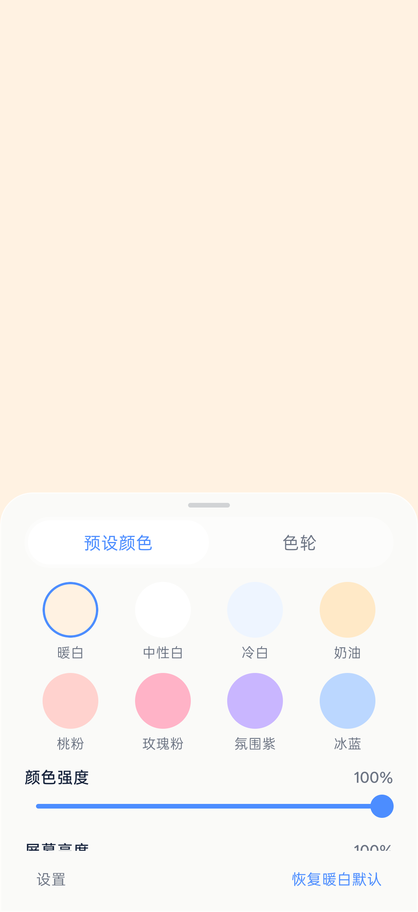

# 夜间补光灯

把备用手机变成随手可用的补光灯：打开就是满屏柔和光源，点一下呼出色轮与亮度控制，拍完收起来就行。

[English](./README.en.md)



## 这是什么

一个离线、免登录的 Android 补光 App，定位是「第二台手机伴侣」：主手机负责拍摄，另一台手机负责补光。

启动后直接进入全屏补光画布，没有欢迎页、首页或登录；不联网、不申请无关权限。

## 能做什么

- **打开即补光**：首启默认暖白、色彩强度 100%、App 屏幕亮度 100%，控制面板收起。
- **全屏沉浸**：颜色铺满可用屏幕，隐藏状态栏与导航栏；补光期间保持屏幕常亮。
- **轻点呼出控制面板**：点补光画布弹出底部毛玻璃面板，点面板外或向下拖动收起；调参不会误关面板。
- **8 个固定预设**：暖白、中性白、冷白、奶油、桃粉、玫瑰粉、氛围紫、冰蓝，4×2 色块一点即换。
- **色轮自定义**：在 HSV 色轮上连续取色，拖动时画布实时跟随。
- **双滑杆**：色彩强度（白色到目标色的插值）与 App 屏幕亮度分开调节；亮度只改当前 App，不动系统全局亮度。
- **记忆上次设置**：再次启动恢复最后一次颜色、强度、亮度与 Tab；控制面板仍默认收起。
- **恢复默认**：一键回到暖白 / 100% / 100%。

## 安装与运行

需要 Node.js 20+ 与 Android Studio；真机为 Android 手机。

```bash
npm install
npm test              # jest 单元测试
npm run typecheck
npx expo run:android  # 编译并安装到已连接设备
```

当前版本号为 `app.json` 的 `1.0.0`；升级请覆盖安装以保留设置。

## 数据与隐私

- 设置只存本机；不联网、不登录、不上传任何内容。
- 不申请相机、定位、通讯录等无关权限；屏幕亮度只作用于本 App。

## 已知限制

- **中英双语界面仍在计划中**（`docs/pm/PRODUCT_PLAN_V2.1.md`，等待人工评审），当前界面为中文。
- 只维护 Android 端；iOS 未实现。
- 屏幕亮度受系统与厂商省电策略影响，个别机型可能无法拉到最高。

## 目录

```text
app/        # 补光画布、控制面板与设置
assets/     # 图标与启动资源
__tests__/  # 组件与逻辑测试
docs/       # 产品计划、验收、交接与治理记录
android/    # 原生工程
```

产品范围见 `docs/pm/PRODUCT_PLAN_V1.1.md`，双语计划见 `docs/pm/PRODUCT_PLAN_V2.1.md`。
